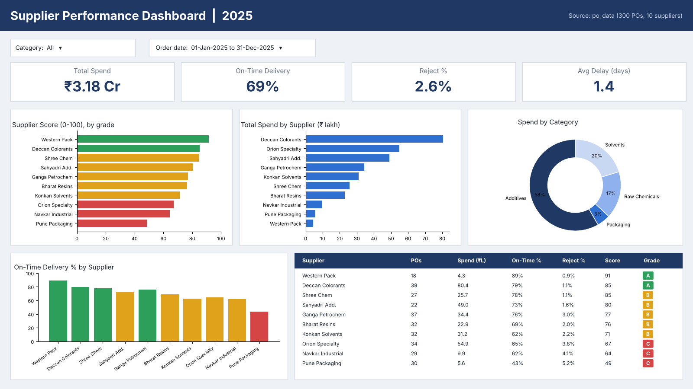

# Supplier Performance Analysis

Analysis of 300 purchase orders from 10 suppliers (2025) to measure delivery, quality and cost performance, and rank suppliers with a score and grade.

*Note: The dataset is synthetic, created for portfolio purposes.*

## Dashboard

## Tools
- Excel: data cleaning, pivot tables, supplier scoring
- SQL: spend, on-time delivery and rejection analysis
- Power BI: dashboard layout design

## Files
- `supplier_po_data.csv`: purchase order data
- `supplier_performance_queries.sql`: SQL queries
- `Supplier_Performance_Analysis.xlsx`: Excel analysis

## Key Findings
- Total spend: ₹3.18 Cr across 300 POs
- Overall on-time delivery is 69%, rejection rate is 2.6%, average delay is 1.4 days
- Western Pack and Deccan Colorants are the top suppliers (Grade A)
- Pune Packaging is the weakest: 43% on-time, 5.2% rejection, score 49
- Additives make up about 58% of total spend

## Metrics
- On-time % = POs delivered on or before promised date / total POs
- Reject % = qty rejected / qty received
- Supplier score (0-100) combines delivery, quality and delay performance
